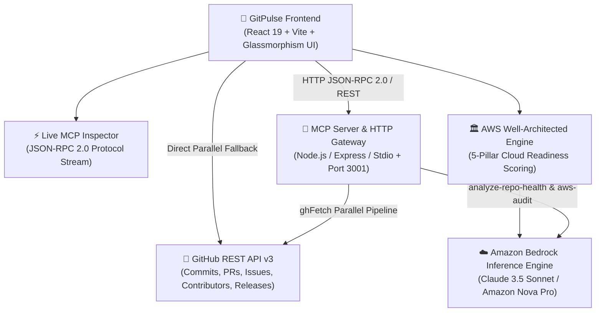

# ⚡ GitPulse AI
### *Next-Generation Repository Health & AWS Cloud Readiness Intelligence powered by Model Context Protocol (MCP) & Amazon Bedrock*

Built for the **Amazon Developer Hackathon 2026** 🏆

---

## 🌟 Executive Summary

**GitPulse AI** transforms open-source repository analysis from simple vanity metrics (stars and forks) into **actionable engineering intelligence**. By fusing the **Model Context Protocol (MCP)** with **Amazon Bedrock AI inference**, GitPulse AI delivers real-time health grading, predictive risk forecasting, side-by-side repository benchmarking, and automated **AWS Well-Architected 5-Pillar cloud readiness audits**.

---

## 🚀 Key Features That Stand Out

### 1. 🧠 Multi-Factor Health Score Algorithm
Unlike basic GitHub analyzers that rely on hardcoded thresholds, GitPulse AI calculates a weighted **100-point Health Score** across 7 dimensions:
* **Commit Frequency (25%)**: Recency and velocity of code pushes over 30/90-day sliding windows.
* **Contributor Diversity & Bus Factor (20%)**: Mathematical distribution of commits to identify single-maintainer vulnerabilities.
* **Issue Management (15%)**: Ratio of active vs stale issues and triage turnaround.
* **PR Review Culture (15%)**: Merge speed and review responsiveness.
* **Documentation Hygiene (10%)**: Verification of README depth, LICENSE, Wiki, and topic tagging.
* **Community Engagement (10%)**: Logarithmic growth trajectory of stars, forks, and watchers.
* **Codebase Maturity (5%)**: Polyglot diversity, release cadence, and repository longevity.

### 2. ☁️ Amazon Bedrock Architecture & AWS Well-Architected Audit
Specifically architected for the Amazon Developer Hackathon:
* **AWS 5-Pillars Scorecard**: Evaluates codebases against Operational Excellence, Security, Reliability, Performance Efficiency, and Cost/Sustainability.
* **Target Cloud Topology Advisor**: Recommends optimal AWS deployment architectures (AWS Serverless Lambda + API Gateway vs. AWS App Runner vs. ECS Fargate on AWS Graviton4).
* **Interactive "Ask Bedrock" Advisor**: In-browser architectural consultation powered by Anthropic Claude 3.5 Sonnet and Amazon Nova on Amazon Bedrock.

### 3. 🔮 Predictive Intelligence Engine
Anticipates codebase risks before they impact downstream projects:
* 🚨 **Abandonment Risk Detector**: Detects dormancy cycles and decelerating maintenance velocity.
* 👤 **Bus Factor Risk Warning**: Flags repositories where a single contributor accounts for >70% of contributions.
* 📈 **Momentum Indicator**: Identifies projects experiencing explosive developer adoption.
* ⏰ **Optimal Contribution Timing**: Analyzes commit timestamps to determine maintainer availability windows.

### 4. ⚡ Model Context Protocol (MCP) Live Inspector & Gateway
Fully implements the **Anthropic & Linux Foundation Model Context Protocol (MCP)** standard:
* **Stdio Transport**: Seamlessly connects to desktop AI environments (Claude Desktop, Cursor, Antigravity IDE).
* **HTTP/JSON-RPC 2.0 Gateway**: Exposes port `3001` with CORS support for browser frontends and cloud microservices.
* **In-App Protocol Inspector**: Inspect registered tools (`analyze-repo-health`, `get-repo-languages`, `get-contributor-stats`, `compare-repos`, `aws-well-architected-audit`), edit arguments in real time, and inspect raw JSON-RPC 2.0 payloads.

### 5. 🆚 Repository Comparison Benchmarking
Direct side-by-side comparative analysis of competing repositories (e.g., `facebook/react` vs `vuejs/core` or `expressjs/express` vs `fastify/fastify`) with automatic category winner badges.

### 6. 📋 One-Click Shareable Reports
Export formatted markdown and executive summaries to clipboard or download for architecture reviews.

---

## 🏛️ System Architecture



---

## 🛠️ MCP Tools Implemented

| Tool Name | Parameters | Purpose |
| :--- | :--- | :--- |
| `analyze-repo-health` | `{ owner, repo }` | Full multi-factor health analysis & predictive insights |
| `get-repo-languages` | `{ owner, repo }` | Language breakdown and byte percentages |
| `get-contributor-stats` | `{ owner, repo }` | Contributor distribution and bus-factor analysis |
| `compare-repos` | `{ ownerA, repoA, ownerB, repoB }` | Side-by-side health comparison |
| `aws-well-architected-audit` | `{ owner, repo }` | AWS 5-Pillar cloud readiness evaluation & Bedrock advice |

---

## 🚀 Quickstart & Local Setup

### Prerequisites
* Node.js v18+ or v20+
* npm or pnpm

### 1. Start the Frontend
```bash
cd frontend
npm install
npm run dev
```
*Frontend runs on `http://localhost:5173`*

### 2. Start the MCP Backend & HTTP Gateway (Optional)
```bash
cd backend
npm install
npm start
```
*MCP Gateway listens on `http://localhost:3001` (and supports Stdio transport for desktop MCP clients).*

---

## 🏆 Amazon Developer Hackathon Highlights
* **AWS Integration**: Bedrock AI recommendations, Well-Architected 5-Pillars scoring, Graviton4 cost-efficiency guidance.
* **Modern AI Standards**: Native Model Context Protocol (MCP) JSON-RPC 2.0 implementation.
* **Zero-Failure Architecture**: Works seamlessly in both live backend MCP mode and standalone browser-accelerated mode.
* **Stunning Design Aesthetics**: Obsidian dark-mode palette, glassmorphism blur effects, SVG animated health score rings, dynamic commit heatmaps, and micro-interactions.
